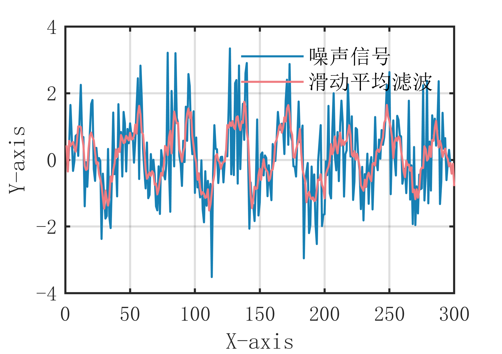

# MATLAB | Digital Signal Processing | Moving Average Filtering Algorithm | Includes data and plotting code | Directly Useable

1. Basic Definition of Sliding Average Filtering: A classic filtering method, the sliding average filtering algorithm eliminates noise by calculating the moving average of the signal. The main idea is to process the signal with a sliding window, averaging the data within the window to obtain a smoothed signal. This effectively removes periodic and high-frequency noise while preserving the overall trend of the signal. Specifically, the steps of the sliding average filtering algorithm are as follows:
Define a filtering window that includes the current sample point and several surrounding points.
Perform averaging on the data within the window to obtain the filtering result for the current sample point.
Move the filtering window forward one position and repeat the above steps until all sample points have been processed. The advantage of the sliding average filtering algorithm is its simplicity and efficiency in computation, which can effectively remove periodic and high-frequency noise; however, it may cause a delay effect on the rapid changes of the signal and the choice of window size also affects the filtering effect.
2. Definition and Outline Effects:
\n        \n  
Outline effects as shown below:
\n        \n          \n          \n          \n          \n            To view this video please enable JavaScript, and consider upgrading to a\n            web browser that\n            supports HTML5 video\n

## Images

<!-- PAYMENT_BLOCK -->

## Get this dataset

- Payment link (Stripe): [Buy now](https://buy.stripe.com/3cs8yP7sY87d0vu9AB)
- Payment QR code: 

<!-- /PAYMENT_BLOCK -->
